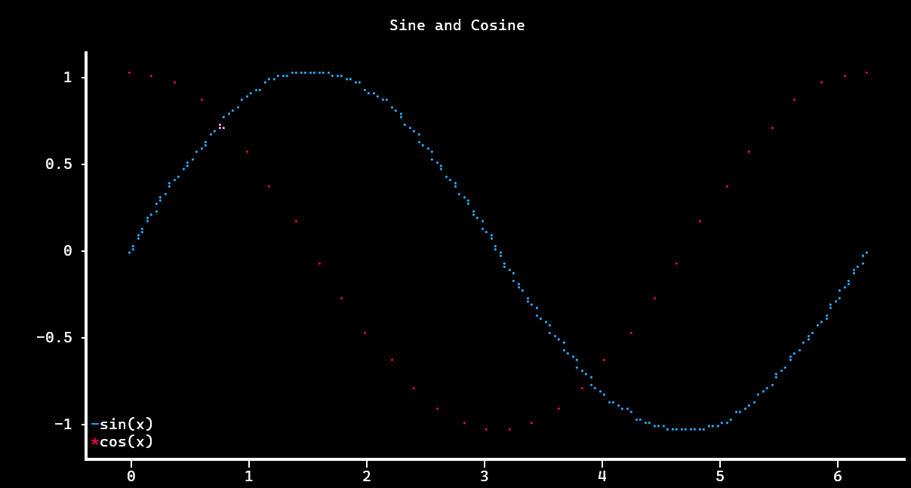

# term-plot

`term_plot.h` is a single header library for plotting directly in the terminal 
inspired by matplotlib, [blot](https://github.com/bartman/blot), and 
[stb](https://github.com/nothings/stb).

## Example Program

This code

```c
#define TERM_PLOT_IMPLEMENTATION
#include "term_plot.h"

#include <math.h>

#define N 32

int main(void) {
    tp_figure* fig = tp_begin(&(tp_figure_desc){
        .subplot_rows = 1,
        .subplot_cols = 1,
    });

    double xs[N] = { 0 };
    double ys[N] = { 0 };

    for (int i = 0; i < N; i++) {
        xs[i] = (double)i / (N-1) * 2.0 * 3.14159;
        ys[i] = sin(xs[i]);
    }

    tp_plot_lines(fig, 0, 0, &(tp_points_desc){
        .num_points = N,
        .xs = xs,
        .ys = ys,

        .label = TP_STR8("sin(x)"),
    });

    for (int i = 0; i < N; i++) { ys[i] = cos(xs[i]); }

    tp_plot_scatter(fig, 0, 0, &(tp_points_desc){
        .num_points = N,
        .xs = xs,
        .ys = ys,

        .label = TP_STR8("cos(x)"),
    });

    tp_setup_axes(fig, 0, 0, &(tp_axes_desc){
        .title = TP_STR8("Example Axes"),

        .flags = TP_AXES_LEGEND,
        .legend_pos_y = 1.0,
    });

    tp_show_and_end(fig);

    return 0;
}
```

produces this graph:


## How to use

`term_plot.h` primarily deals with figures (of type `tp_figure*`). One figure 
contains a grid of subplots, where each subplot has a set of axes. Create 
figures with `tp_begin(...)`, reset figures with `tp_reset(...)`, and destroy 
figures with `tp_end(...)` or `tp_show_and_end(...)`. Each set of axes can be 
configured using `tp_setup_axes(...)`. You issue plotting commands to an
individual set of axes, using one of the `tp_plot_*(...)` functions. To view 
the output, simply call `tp_show(...)` or `tp_show_and_end(...)`.

You can also get a UTF-8 stream for the figure by calling `tp_render_utf8(...)`. 
It is worth noting however that 1) non-monochrome figures will have ANSI escape 
codes included in this stream (set `monochrome` to true in your `tp_figure_desc` 
to avoid this), and 2) directly printing this output might not work in some 
terminals without first calling `tp_enable_utf8_output()`.

## How to build

`term_plot.h` can be included as a header file anywhere, but you must pick 
exactly one C/C++ file and write the following:

```c
#define TERM_PLOT_IMPLEMENTATION
#include "term_plot.h"
```

`term_plot.h` uses `math.h`, so make sure to add `-lm` to link to math.

